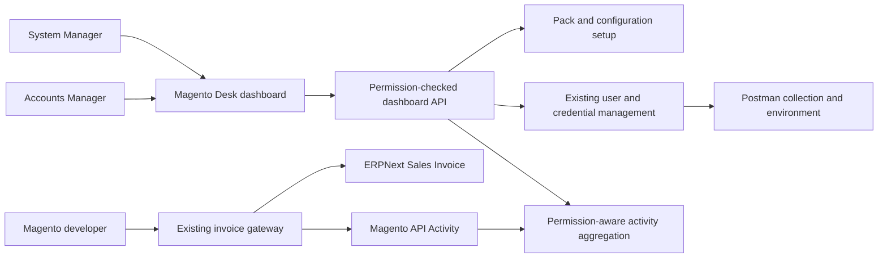
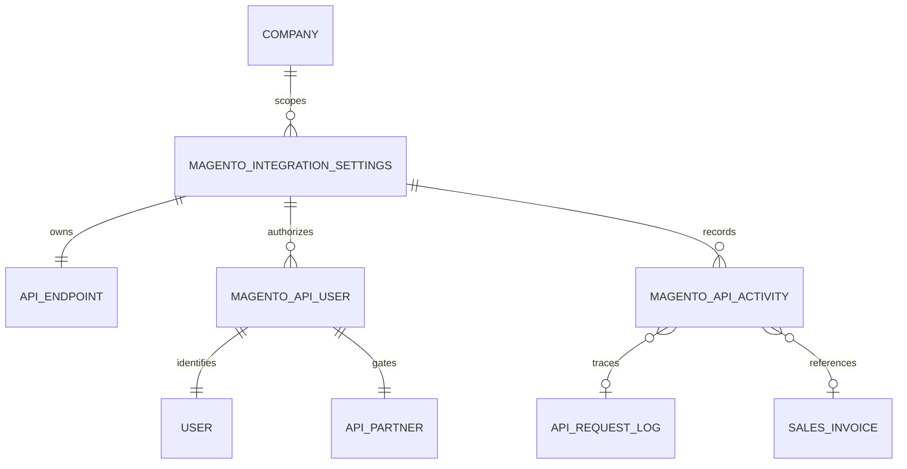
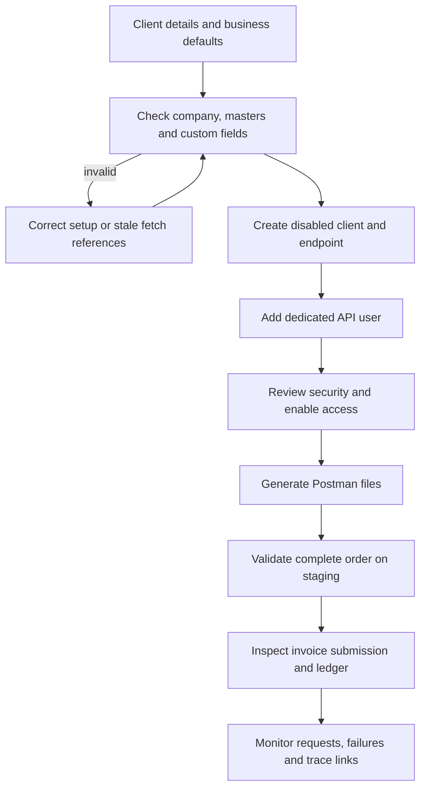
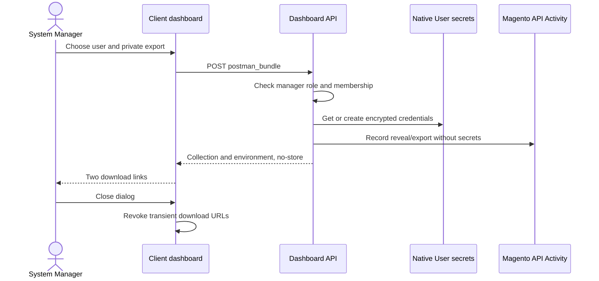
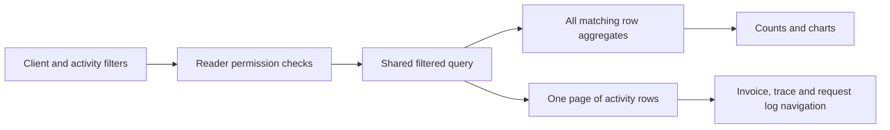

# Magento client dashboard

[README](../README.md) · [Configuration](MAGENTO_CONFIGURATION.md) · [Sandbox acceptance](SANDBOX_ACCEPTANCE_2026-10-30.md)

## Contents

- [Purpose and access](#purpose-and-access)
- [Architecture](#architecture)
- [Onboard a client](#onboard-a-client)
- [Postman delivery](#postman-delivery)
- [Monitoring](#monitoring)
- [Server API](#server-api)
- [Deployment and development](#deployment-and-development)
- [Limits and failure recovery](#limits-and-failure-recovery)

## Purpose and access

Open **Magento Integration → Client Dashboard**, or `/app/magento-dashboard`. Existing configuration forms have a **Client Dashboard** button. This Desk page combines setup, user access, credential delivery and monitoring.

**System Manager** can set up clients, edit security/defaults, add or remove dedicated users, change create/submit permissions, rotate/revoke credentials and export Postman files. **Accounts Manager** can read configurations and monitor activity, but cannot manage users or export credentials. Managed Magento API users cannot call dashboard methods. Every server entry point checks permissions; hiding a button is not the authorization boundary.

## Architecture

No new business DocType is introduced. The page uses the existing configuration, membership, native User secrets and append-only activity records.

## Onboard a client

1. Select **Set up new client**. Supply a unique name and endpoint slug, company, enabled non-group cost center and enabled sales tax template belonging to that company. The current complete-order contract supports SAR.
2. Supply required Sales Invoice custom defaults as a JSON object. Existing Select/Link values are checked. Only scalar custom header fields are accepted. Do not copy PowerTire's sales representative or cost-center names to another customer.
3. Set IP/CIDR restrictions, HMAC and requests per minute. Blank IP rules allow all source IPs; rate 0 means unlimited. Rate counters are per user/partner per minute and span gateway routes.
4. Create the configuration. It starts **disabled**. The wizard installs the complete-order pack, its three Magento invoice fields and a dedicated endpoint. A disabled bootstrap partner has no user or token. Existing endpoint slugs are rejected rather than overwritten.
5. Add a dedicated API user, choose create and submit permissions, review setup checks, then enable the integration. The configuration-wide submission switch and each user's submission switch must both permit submission.
6. Export Postman files, use a real existing SKU and the client's agreed totals, then run **Validation — no invoice saved** on staging. Run the separate write folder only when creating/submitting accounting test documents is intended.
7. Review the Sales Invoice, ledger and trace report. Obtain separate acceptance for tax compliance, payment/stock posting or other workflows outside this contract before production traffic.

The wizard supplies header/item cost centers and appends `neo_connect.handlers.commerce.ensure_cost_center` after `neo_connect.handlers.powertire.prepare_invoice`, so tax rows created by the invoice handler receive a cost center too. Automatic cost-center creation is disabled. It detects stale static `fetch_from` fields but does not silently modify client customizations.

## Postman delivery

Each user has **Postman downloads**. The default produces a collection and a blank credential environment. Explicitly select **Include API key, secret and HMAC secret in private environment** to generate/retrieve native API credentials and receive a private environment.

- Download each file using its link. Import both into Postman and select the environment.
- `base_url`, endpoint and user come from the selected configuration. `item_code` deliberately requires a real client SKU. The illustrative 15% tax payload must be adjusted to match the client's tax template and financial totals.
- The pre-request script initializes an order number, invoice number and timestamp when blank. Keep them for retries; clear/change all three for a new order. One complete order maps to one invoice.
- When HMAC is enabled, the script resolves variables, freezes the outgoing raw body and signs those exact bytes with HMAC-SHA256 in `X-Signature`. The signing secret is separate from the API secret.
- Collection files contain variable references, never credentials. Customer/address examples are synthetic; the endpoint's stored sample customer/payment metadata is not exported.
- Private export responses use `Cache-Control: no-store`. Secrets stay in the generated file and transient browser download blobs, not configuration fields, browser local storage or audit details. Closing the dialog revokes the blob URLs. The downloaded file remains plaintext JSON despite Postman's `secret` type; distribute it only through the intended secure channel.
- `Postman Exported` and credential created/revealed/rotated events record the admin actor, target user and configuration, without secret values.
- **Rotate secret** invalidates the prior API token. Download and distribute a fresh environment afterward. **Revoke** disables access. **Remove** disables the user, rotates the token secret and removes membership while retaining history. Re-adding the same dedicated user does not revive the removed token.

## Monitoring

The page supports configuration, dates, API user, outcome, HTTP status, Magento order, ERP document, trace ID and action filters. It shows counts, average duration, outcome distribution, activity by day, HTTP response distribution and the ten busiest users. The table links directly to the invoice, activity trace and request log.

Charts and counts use permission-aware database aggregation over **all matching rows**, not just the visible 25-row page. Date ranges are capped at 366 days; table API page sizes are capped at 100. Administrative events are included and may have no HTTP status/duration. Filter Action to `API Request` for API-only analysis. Empty results are explicit. Previous/Next page controls retain filters. The existing report remains available for exports and additional filters.

## Server API

Methods are under `neo_connect.dashboard`. Use an authorized Desk session; these are administrative APIs, not Magento delivery endpoints.

| Method | Access | Behavior |
| --- | --- | --- |
| `bootstrap` | Reader | Accessible configurations and manager capability |
| `client(config)` | Reader | Security, users without credentials, business defaults and static readiness |
| `overview(filters, start, page_length)` | Reader | Filtered aggregate metrics and paged trace rows |
| `create_client(values)` | Manager, POST | New disabled client and unique complete-order endpoint |
| `save_client(config, values)` | Manager, POST | Validate business/security inputs, save defaults and synchronize members |
| `set_user(config, user, enabled, can_create, can_submit)` | Manager, POST | Update existing membership; cannot adopt unrelated users |
| `postman_bundle(config, user, include_secrets)` | Manager, POST | Collection plus blank/private environment; no-store response |

`values`/`filters` accept JSON objects or JSON-encoded objects. Security settings validate boolean switches, IP/CIDR syntax and rate bounds. Configuration company/endpoint remain immutable. User lifecycle and credential operations reuse `neo_connect.management`.

## Deployment and development

Deploy v1.3.0 through the site's normal app deployment process, run `bench --site <site> migrate`, clear cache, and reload Desk. The new page is standard module metadata, not a client script pasted into a customer site. No credentials, test users or client-specific defaults are installed by migration. Existing clients are not automatically reconfigured.

Code locations:

- `neo_connect/dashboard.py`: permissions, readiness, setup, aggregation and exports.
- `neo_connect/postman.py`: pure portable document builder.
- `neo_connect/neo_connect/page/magento_dashboard/`: Desk page metadata and JavaScript.
- `neo_connect/tests/test_postman_bundle.py`: portable export regressions.
- Existing management, audit, configuration and pack modules remain the owners of their respective rules.

Run unit discovery, Python compilation, JavaScript syntax checks and real staging HTTP tests. Verify manager/read-only/managed-user access independently, setup collisions, invalid company/master/default inputs, all-row aggregates versus paging, exact-body HMAC, private export no-store/redaction and old-token rejection after rotation/removal. See [sandbox and local results](SANDBOX_ACCEPTANCE_2026-10-30.md) for the tested scope and hosting exception.

## Limits and failure recovery

- Static readiness does not execute every ERPNext/custom-app validation. Mandatory child fields, accounting periods, tax/account mappings, item tax rules, customer identity, discounts, shipping and third-party hooks still require client-specific acceptance.
- Schema installation of missing Custom Fields can involve DDL commits. If onboarding fails during schema creation, those additive fields may remain. Configuration/endpoint collisions are checked up front; inspect partial setup before retrying. Do not delete client data to retry.
- The dashboard uses the existing complete-order contract: no partial invoices, returns, stock posting or Payment Entries. Magento payment information does not mark the invoice paid. ZATCA clearance/reporting is separate.
- HMAC signs the raw body; it does not add a timestamp/nonce anti-replay protocol. Existing order identity/content-hash deduplication protects invoice retries.
- Hosting proxies may rewrite HTTP 429 responses. Preserve HTTP status, JSON content and trace headers in the proxy configuration where supported. A client must handle a non-JSON 429 with backoff, retaining the same order identity; correlate site logs by time/user/order when the proxy removes trace headers.
