# Required sales representative during Magento setup

[Dashboard guide](MAGENTO_DASHBOARD.md) · [README](../README.md) · [Changelog](../CHANGELOG.md)

## Contents
- [Cause](#cause)
- [Admin correction](#admin-correction)
- [Patch and verification](#patch-and-verification)

## Cause

The reported live v1.3.0 setup used `{}` for Client custom field defaults. The site's Sales Invoice requires `custom_sales_representative_name`, without a field default or fetch source. Creation correctly stopped before creating the client/partner/endpoint. This protects native invoice validation. The error was insufficiently actionable, and the dialog callback left an uncaught rejected promise in the browser console.

## Admin correction

1. Open **Customize Form**, choose **Sales Invoice**, and find fieldname `custom_sales_representative_name`. Check its label, field type and Options. Do not remove Mandatory to bypass setup.
2. If it is a Link, choose the exact existing document name from the DocType in Options. If it is a Select, use an exact listed option. For a text field, agree the value with the client. Do not assume the sandbox's `المغسلة` value is appropriate or even exists on production.
3. Return to **Magento Integration → Client Dashboard → Set up new client**. Enter this in **Client custom field defaults**, replacing the placeholder with that approved exact value:

```json
{
  "custom_sales_representative_name": "EXACT EXISTING VALUE"
}
```

4. Retain any other required custom defaults in the same JSON object. Retry **Create disabled client**. A rejected prerequisite check creates no client; if a client/endpoint already exists from another successful attempt, open its configuration instead of creating a duplicate.
5. Review setup checks, add the dedicated API user, then perform controlled Postman dry-run and invoice acceptance. Enable access only when the client is ready. Confirm the resulting invoice has the intended sales representative.

If representatives vary per order, a fixed client default is not sufficient: agree and implement the payload mapping before production traffic. This patch does not add such a mapping or choose business values automatically.

```mermaid
flowchart LR
    requiredField["Required Sales Invoice custom field"] --> inspectField["Inspect field type and Options"]
    inspectField --> approvedValue["Choose approved existing value"]
    approvedValue --> clientDefaults["Enter client JSON defaults"]
    clientDefaults --> prerequisiteCheck["Validate prerequisites"]
    prerequisiteCheck --> disabledClient["Create disabled client"]
    disabledClient --> invoiceAcceptance["Verify representative on test invoice"]
```



## Patch and verification

v1.3.1 includes the label, fieldname, expected Link DocType or Select options, and JSON correction instructions in readiness/validation messages. Metadata is escaped for Frappe message rendering. The setup and edit dialogs retain values and re-enable their action after a rejected call; Frappe still displays its server error. Required fields and existing Link/Select validation are preserved.

Verification on 5 November 2026: 59 Python unit/mock tests passed, including seven new prerequisite regressions; two JavaScript dialog rejection/retry cases passed; Python compilation, JavaScript syntax and diff whitespace checks passed. These checks did not alter the live site. The patch has not been deployed or verified on the customer's live server.

The workaround works on v1.3.0. To obtain clearer messages deploy v1.3.1 through the normal hosting process, run site migration and clear cache, then reload Desk. No schema change or automatic client data repair is included.
