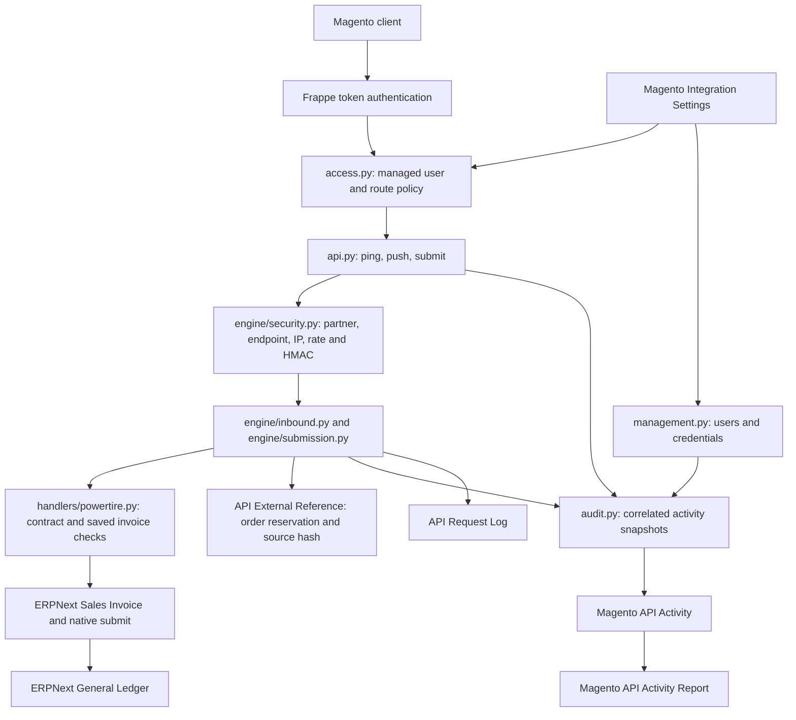
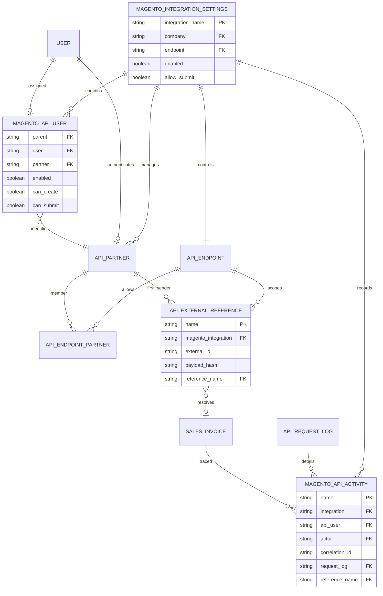
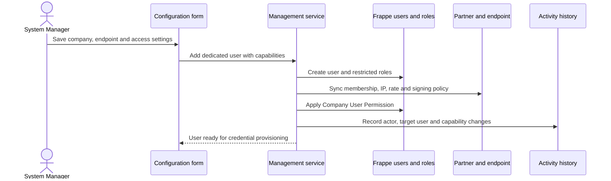
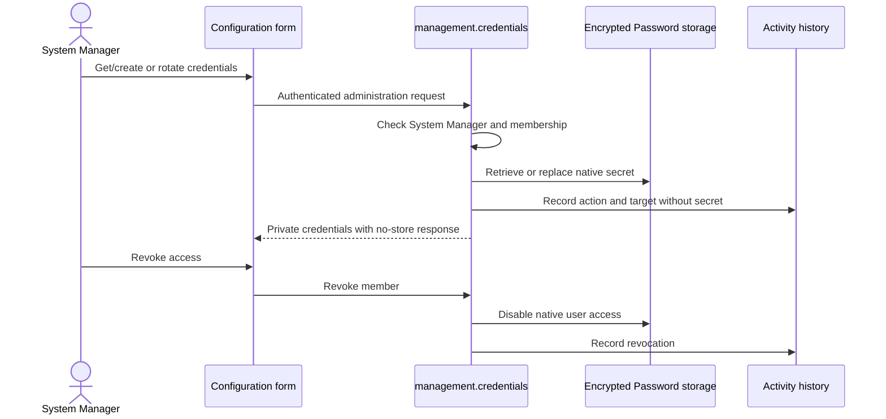
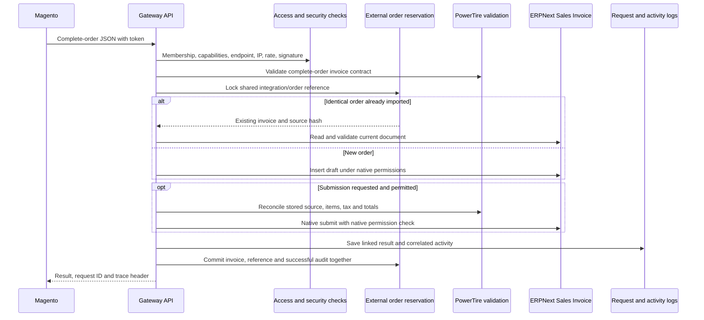
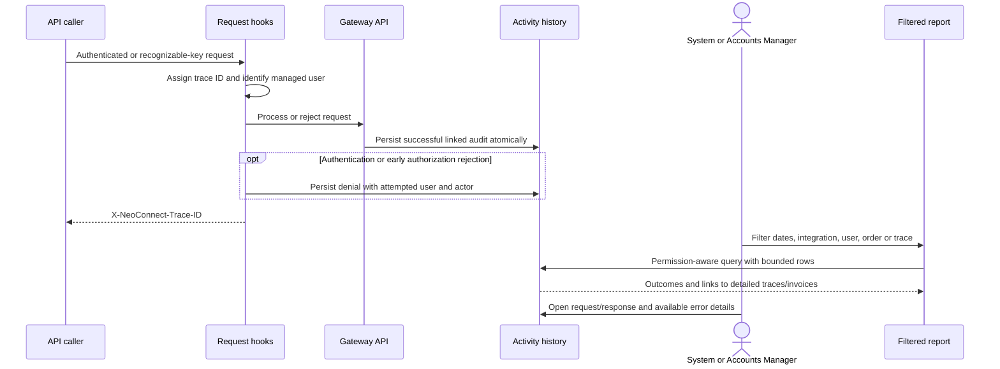

# NeoConnect introduction

[README](../README.md) | [Configuration](MAGENTO_CONFIGURATION.md) | [Development](DEVELOPMENT.md) | [Changelog](../CHANGELOG.md)

NeoConnect is a Frappe custom app for controlled integration with ERPNext. Release 1.2.0 provides a verified Magento complete-order Sales Invoice flow, central access administration, encrypted credential management and correlated activity reporting. The source also contains generic mapping, sample-analysis and outbound capabilities inherited from the supplied 1.0.0 sample; those capabilities do not expand the verified PowerTire contract.

## Contents

- [Architecture overview](#architecture-overview)
- [DocType model](#doctype-model)
- [Central configuration and user access](#central-configuration-and-user-access)
- [Credential lifecycle](#credential-lifecycle)
- [Invoice creation and submission](#invoice-creation-and-submission)
- [Traceability and reporting](#traceability-and-reporting)
- [Extension points](#extension-points)
- [Operational boundaries](#operational-boundaries)

## Architecture overview

`hooks.py` registers authentication and request hooks plus install/migrate role setup. Generic transformations stay in `engine/mapper.py`; customer-specific business validation belongs in handlers. The managed integration must retain synchronous processing and native ERPNext permissions.

## DocType model

The diagram shows logical relationships. Invoice references use a DocType plus Dynamic Link, and Frappe application Links are not database foreign-key constraints. One endpoint belongs to one central configuration. A dedicated API user can belong to one central configuration. Multiple assigned users share the same integration/endpoint/order namespace, so changing sender does not create another invoice.

## Central configuration and user access

**Purpose:** administer the company's Magento access in one form. Open the **Magento Integration** workspace, select **Configurations**, and create **Magento Integration Settings** against the reviewed PowerTire endpoint. See the [configuration guide](MAGENTO_CONFIGURATION.md) for every field and button.

**Key components:** Settings controller, child **Magento API User**, **API Partner**, native **User**, Company **User Permission**, `management.add_user`, `management.remove_user`, `access.enforce_managed_user`, and `install.after_migrate`.

**Edge cases:** personal ERP users and Administrator/Guest cannot be adopted. Company/endpoint identity is fixed after creation. Removing a user preserves historical documents while disabling native access and replacing its secret. Disabling the configuration disables assigned users. Create and submit capabilities are independent, while the global submission switch also applies. Dedicated users can call only their configured gateway's ping/push/submit paths; native REST and general RPC paths are denied.

## Credential lifecycle

**Purpose:** allow System Managers to create, retrieve, rotate and revoke API credentials without managing secrets in spreadsheets or source files. Use **Credentials** on the configuration. `management.credentials` supports `get_or_create`, `get`, `rotate` and `revoke`; the native User Password field stores the encrypted secret. When HMAC is enabled, signing secrets live in API Partner Password storage.

**Edge cases:** rotation replaces the secret while preserving the key identifier. Revocation disables membership and native login; removal also changes the secret. Retrieval itself is audited. Existing managed partners cannot bypass the configuration with legacy partner credential buttons. Full Postman runner exports can contain credentials and must remain private.

## Invoice creation and submission

**Purpose:** import one issued invoice for each complete Magento order, then submit through ERPNext's native controller. Use the [API contract](POWERTIRE_API.md), bundled `powertire_complete_order_invoice.json` pack and [Postman collection](powertire.postman_collection.json).

| Method | Behavior |
| --- | --- |
| `GET neo_connect.api.ping` | Confirm credentials and permitted endpoint |
| `POST neo_connect.api.push?endpoint=<slug>` | Validate and create a draft |
| `POST neo_connect.api.push?endpoint=<slug>&submit=1` | Create and submit, or promote the identical existing draft |
| `POST neo_connect.api.submit?endpoint=<slug>` | Submit the imported draft identified only by `order_number` |

Add `dry_run=1` to validate without persisting invoice changes. All paths include `/api/method/` before the dotted method.

**Edge cases:** changed retries, cancelled/deleted targets, edited financial values, incomplete quantities and unsupported discounts/refunds require rejection or reconciliation. The reference lock precedes creation and serializes simultaneous deliveries. Legacy references are adopted safely into the central namespace; conflicting historical targets block configuration saving. Customer-specific workflows and e-invoicing hooks still run during native submission and require customer staging acceptance.

## Traceability and reporting

**Purpose:** connect a sender and request to the resulting accounting document or rejection. Open **Activity Report**, **Trace Logs**, or **User Activity** from configuration. The workspace also exposes report and log shortcuts.

**Key components:** `audit.before_request`, `audit.from_log`, `audit.after_request`, **Magento API Activity**, **API Request Log**, and **Magento API Activity Report**.

**Edge cases:** structured credential values are redacted. Unknown keys cannot be attributed to an integration. Activity records reject edits/deletion through the application; database administrators remain able to alter database contents. Managed activity and linked detail logs have no automatic expiry. The report summarizes its displayed rows, has a default 1,000-row limit and maximum 5,000, and asks reviewers to narrow filters when capped.

## Extension points

Follow [DEVELOPMENT.md](DEVELOPMENT.md) and [CONTRIBUTING.md](../CONTRIBUTING.md). Keep request dispatch in `api.py`, policy in `access.py` and `engine/security.py`, reusable mechanics in `engine/`, business hooks in `handlers/`, and standard metadata under `neo_connect/doctype`, `report` and `workspace`. New integrations should use a pack or handler rather than weakening the PowerTire contract. Store schema changes in the repository and migrate them through Frappe.

## Operational boundaries

The verified release is 1.2.0 on Frappe 15.118.0 / ERPNext 15.119.3. Version 16 has not been tested. The customer site has not been deployed. The PowerTire flow records payment metadata without creating payment or stock postings and rejects discounts, refunds and partial invoices. Generic inherited presets have different contracts; read their configuration and test them separately before use. See [verification](VERIFICATION.md), [release notes](RELEASE_v1.2.0.md) and [changelog](../CHANGELOG.md).
